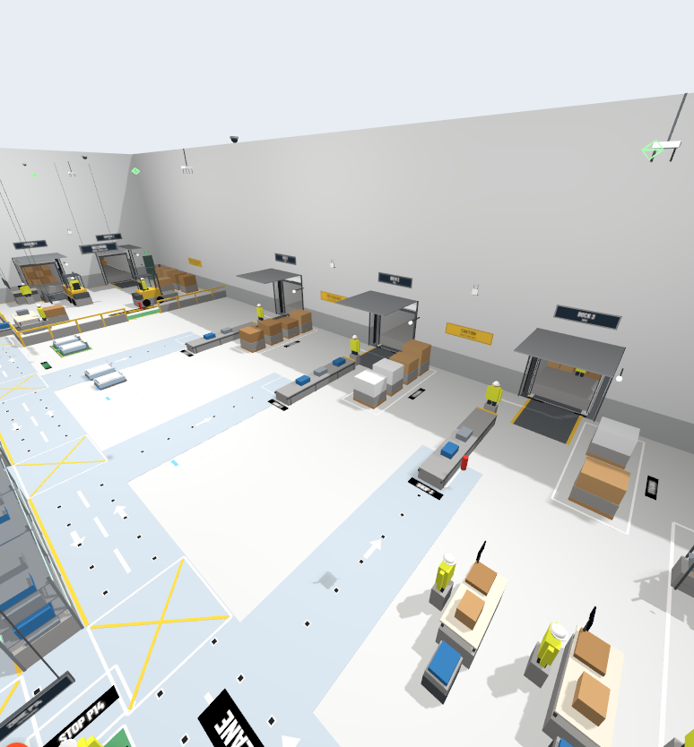

# NRDA Fleet OS

**Edge-AI decentralised fleet coordination for autonomous mobile robots in smart warehouses.**

<p align="center">
  
  <br>
  <em>The NRDS warehouse in Gazebo Harmonic &mdash; inbound docks, conveyor lines and the marked lane network the fleet reserves space-time on.</em>
</p>

Twenty AMR-01 tote transporters (`AMR_1` … `AMR_20`) work the NRDS warehouse in Gazebo Harmonic and RViz.
- Each robot runs its own edge agent, and there is no central planner.
- Robots bid for transport tasks, reserve space-time on a shared lane network, and bypass blocked lanes.
- Two 270° lidars per robot feed obstacle tracking, collision-risk prediction and a lidar safety stop.

Operators watch the fleet, count collisions and release tasks from a web console.

The coordination algorithm is **NRDA-FA**: a five-layer onboard stack covering task and health, allocation, routing with space-time reservation, local coordination, and motion with safety. See [`docs/FINAL_ALGORITHM.md`](docs/FINAL_ALGORITHM.md) for the specification and [`docs/FINAL_AUDIT.md`](docs/FINAL_AUDIT.md) for every algorithm with its published source and mathematics.

## Quick start

```bash
./nrda.sh build          # colcon build: core, warehouse, messages, fleet runtime (~30 s)
./nrda.sh sim            # Gazebo + RViz + web console (http://localhost:8080) + 20 AMRs
```

The 20 AMRs start parked (5 at chargers, 15 in sleeping bays) with full batteries and wait for work: release
tasks from the console (**Release 10 random tasks**, or the task form with auction or direct assignment).
`scenario:=demo` releases six tasks per minute automatically instead. RViz shows:
- the fleet coloured by activity;
- each robot's live lidar scans, route and reserved lane cells;
- collision and near-miss markers.

The browser console opens automatically.

| Command | What it does |
|---|---|
| `./nrda.sh sim scenario:=busy` | Peak load stress test: 20 robots, 16 tasks per minute (reaches 225–251 tasks/hr) |
| `./nrda.sh sim` | Standard interactive simulation: Gazebo GUI + RViz + Web Console (http://localhost:8080) |
| `./nrda.sh sim sensor_profile:=fleet` | Gazebo GPU lidars instead of the CPU lidar model (runs at about half real time on a 4 GB GPU) |
| `./nrda.sh sim gui:=false` | Headless Gazebo: RViz and the console only (~1.0x real time) |
| `./nrda.sh sim sim_speed:=1.5` | Ask Gazebo for 1.5x real time (when CPU has headroom, e.g. with `gui:=false`) |
| `./nrda.sh test` | 180 unit and integration tests (100% pass rate, ROS-free) |
| `./nrda.sh bench --quick` | Scenario benchmark in the 2-D simulator, then the KPI report |
| `./nrda.sh stop` | Stop every simulation process cleanly |

Requirements: Ubuntu 24.04, ROS 2 Jazzy, Gazebo Harmonic (`ros-jazzy-ros-gz`), `ros-jazzy-nav2-map-server`, and Python 3.12 with numpy, pyyaml and matplotlib. No other Python packages are needed.

## Architecture

```
          Web console (live map · collisions · task allocation · KPIs)      RViz2
                        │  REST + Server-Sent Events                          │
                 fleet_gateway (injects tasks / operator commands, observes)   │
   ════════════ ROS 2 peer bus  /fleet/state · claims · bids · tasks · alerts · control ════════════
        │                 │                         │                       │
  AMR_1 edge agent   AMR_2 edge agent   …    AMR_20 edge agent      safety_monitor (independent:
  ┌─────────────────────────────────────┐                          contacts, footprint overlap,
  │ L5 task · battery · health          │                          near misses → /fleet/safety_events)
  │ L4 CBBA auction (lane-graph costs)   │
  │ L3 lane-graph route + space-time     │
  │    claims (owner-authoritative)      │
  │ L2 visison bypass planner            │
  │ L1 lidar tracking + risk · ORCA-DD · │
  │    MotionArbiter · lidar safety stop │──▶ /AMR_i/cmd_vel   (the only writer)
  └─────────────────────────────────────┘◀── /AMR_i/odom, /AMR_i/scan_front, /AMR_i/scan_rear
        Gazebo Harmonic: NRDS warehouse, 20 × AMR-01 (diff drive, 2 lidars, IMU, contact sensor)
```

- **Decentralised.** Robots share only peer messages: state, claim snapshots, CBBA bids and alerts. The gateway never allocates or plans; it only releases tasks and relays operator commands.
- **One motor-command writer per robot.** Every layer submits intents to the robot's `MotionArbiter` (priority OPERATOR > EMERGENCY > FLEET > PLANNER). The lidar safety stop can only lower the result.
- **Edge AI on board:**
  - lidar clustering on a static-map filter;
  - alpha-beta tracking and a probabilistic collision-risk model (P = Φ(−m/σ));
  - unmapped-obstacle detection shared with the fleet;
  - congestion learning of lane travel times, fed into routing and bids;
  - adaptive compute (plans at 4 Hz while driving, 1 Hz while parked).

More detail: [`docs/ARCHITECTURE.md`](docs/ARCHITECTURE.md), [`docs/INTERFACES.md`](docs/INTERFACES.md), [`docs/SAFETY_CASE.md`](docs/SAFETY_CASE.md), [`docs/OPERATIONS_RUNBOOK.md`](docs/OPERATIONS_RUNBOOK.md).

## Repository

| Path | Contents |
|---|---|
| `core/visison/` | Core algorithm: reservation-aware bypass planner, ORCA-DD, emergency and standoff logic, MotionArbiter |
| `core/nrda_fleet/` | Integration layer, ROS-free: site model, lane graph, claims, scheduler, CBBA allocation, DRP deadlock resolution, edge agent, safety, 2-D simulator, metrics |
| `core/tests/` | Test suite: **180 unit and integration tests** (100% pass rate) |
| `ros2_ws/src/nrds_warehouse_sim/` | NRDS warehouse world (open roof, 2 m racking: `scripts/declutter_mesh.py`), AMR-01 model, 10 chargers, 15 sleeping bays, fleet roster, Gazebo/RViz launch |
| `ros2_ws/src/nrda_msgs/` | Typed peer-bus interfaces (`RobotState`, `ClaimSet`, `Bid`, `Alert`, `Control`, etc.) |
| `ros2_ws/src/nrda_fleet_ros/` | Edge-agent node, lidar emulator, safety monitor, RViz fleet view, web gateway and console (`web/`) |
| `benchmarks/` | Scenario definitions, the 2-D runner and the KPI report |
| `docs/` | Architecture, interfaces, safety case, algorithm audit and operations runbook |

## Single-File Corridor Engineering & Deadlock Elimination

In high-density warehouse operations (20 AMRs), narrow aisles and single-file corridors can become severe choke points. A major bottleneck in the NRDS layout was **Corridor `VE`** (width $w = 0.975\text{ m}$ per lane, total aisle $< 2.0\text{ m}$), which connects the decant pickup and charging stations to the main warehouse:
- **Root Cause:** Passing requires $\ge 1.5\text{ m}$ clearance. With an 8–10 s rolling reservation window vs. a 48 s transit time, opposing AMRs frequently entered simultaneously, resulting in head-on standoffs that chain reverse (1.4 m) could not clear.
- **Directional Enforcement:** Implemented `is_lane_enabled(line_name, lane)` in `nrda_fleet/lane_graph.py` to enforce Corridor `VE` as strictly one-way (Northbound Lane `A` only). All 8 stations along `VE` face North; Southbound traffic is routed through parallel wide aisle `V14` ($w = 1.2\text{ m}$), preserving **100% reachability across all 1,892 station pairs**.
- **Standoff Rerouting:** In `nrda_fleet/deadlock.py`, the Distributed Deadlock Resolution Protocol (`DRP`) identifies `single_file_standoff` conditions where chain reverse is geometrically infeasible. The loser robot is assigned to dynamically reroute (`Move(loser.rid, "reroute", 0.0, 0)`) to clear the corridor.
- **Legal Hold Prohibition:** Enforced `_is_legal_hold(..., is_peer=bool(auth_blockers))` in `nrda_fleet/scheduler.py` to prevent yielding robots from holding inside single-file corridors.

## Live Simulation Benchmarks (Peak Load)

Under peak stress testing (`scenario:=busy`, 240 tasks released at 16 tasks/min across all 20 AMRs):
- **Throughput:** Peak **251.2 tasks/hr**, sustained **225.6 tasks/hr** ($>2\times$ the target 120 tasks/hr).
- **Fleet Utilization:** **84.4%** across all 20 AMRs simultaneously.
- **Safety Record:** **0 robot-robot collisions**, **0 near-misses**.
- **Autonomous Recovery:** **0 unhandled deadlocks** (`needs_you` operator alerts = 0); all transient contentions resolved autonomously via DRP.

## Behaviour notes

- **Batteries** stay at 100 % (`AgentConfig.battery_model = False`); chargers are docking spots and showcase pieces.
- **Collision recovery**: the safety monitor pauses robots involved in a contact; each one waits 3 s, backs 0.4 m towards the side its lidar shows clear and resumes. An operator pause is only released by the operator.
- **Latency compensation**: in Gazebo, commands reach the wheels and feedback returns about 0.1 s late (`actuation_latency` parameter). Tracking and the lidar safety fields act on the pose predicted that far ahead.
- **Traffic rules added for 20 robots**: robots do not stop inside crossings or in a station's doorway; a robot inside a crossing has right of way; bookings behind a stuck robot's first wait are tentative; a wait-for cycle is broken by the member that can move backing off or rerouting; ORCA ignores followers (the follower keeps the gap).
- **Demo test**: *Simulate a motor fault* (robot details) stops a robot as if its motor failed, to show the fleet re-planning around it; *Clear the fault* undoes it.
